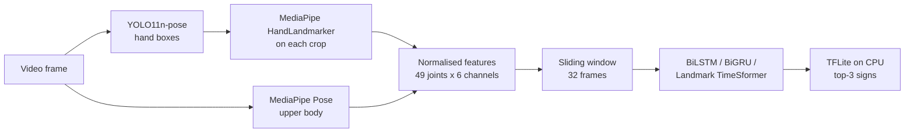
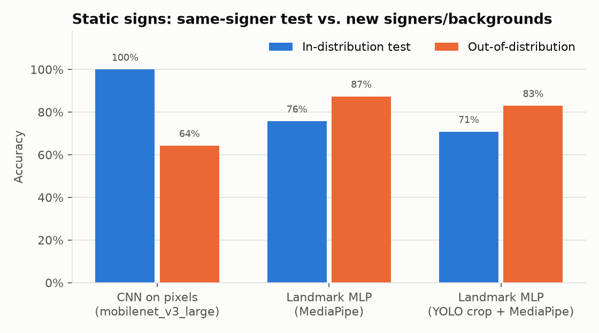
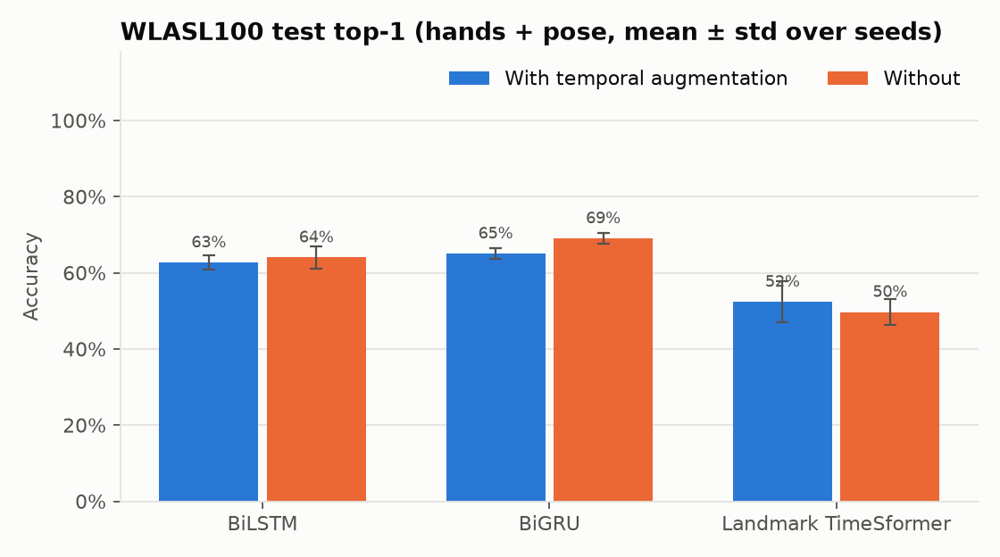
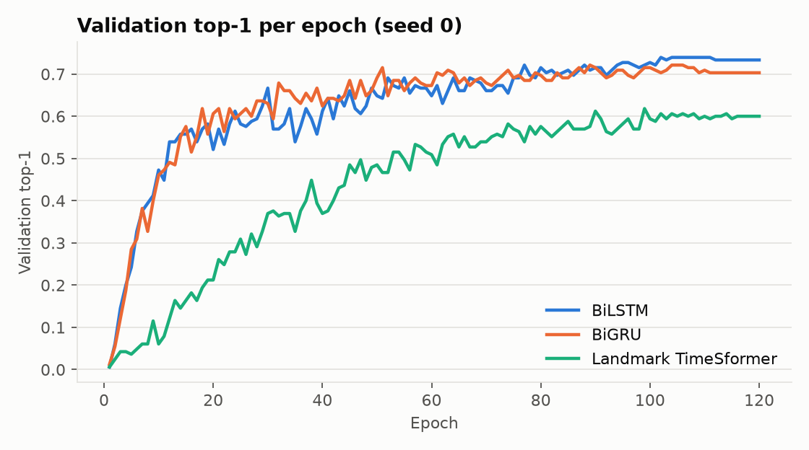
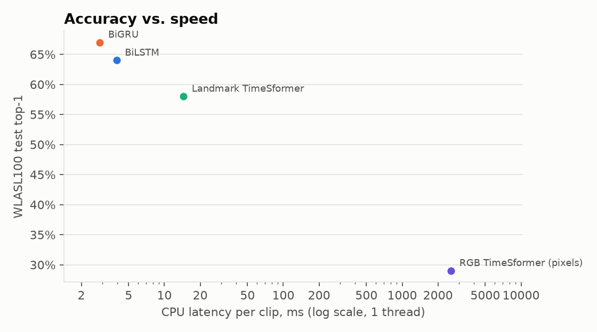

# Sign Language Recognition: YOLO + MediaPipe Landmarks + Sequence Models on TensorFlow Lite

Recognises **American Sign Language** from images and video in real time:

- **Static signs:** the 29-class ASL alphabet, from single images
- **Word-level signs:** WLASL100, the standard 100-word video benchmark, using its official
  train/val/test split

The approach throughout is to turn pixels into **hand landmarks** first, then classify those:

1. A YOLO detector finds each hand.
2. MediaPipe extracts 21 3D landmarks from each hand crop.
3. A small sequence model (BiLSTM, BiGRU, or a TimeSformer-style space-time transformer)
   classifies the movement.
4. The model runs on CPU through TensorFlow Lite.



## What this project measures

- **Does YOLO cropping help MediaPipe?** Hand-detection rate with and without YOLO crops, on the
  same images and videos. WLASL hands are often small in full-body footage.
- **Landmarks vs. pixels:** a landmark MLP vs. a CNN on raw images, tested both on the
  same-signer test split and on a separate ASL Alphabet Test set with new people, backgrounds
  and lighting.
- **Which sequence model and features work best on WLASL100:**
  - BiLSTM vs. BiGRU vs. a TimeSformer-style transformer
  - with vs. without temporal augmentation
  - hands only vs. hands + upper-body pose
  - each configuration over 3 seeds, reported as mean ± std
- **The accuracy / speed trade-off:** landmark models next to a 121M-parameter pixel TimeSformer
  fine-tuned from Kinetics-400, and next to published WLASL100 baselines.
- **Deployment:** TFLite size, CPU latency, agreement with PyTorch on the full test set, and
  end-to-end FPS of the live pipeline.

## Results

Every number below is produced by `slr/report.py` from the experiment outputs and written into this
file automatically. Nothing is typed by hand; "not run yet" marks experiments that haven't been run.

<!-- RESULTS:START -->
### 1. Hand detector (YOLO, Ultralytics Hand Keypoints val set)

| Model | Box mAP50 | Box mAP50-95 | Keypoint mAP50 |
|---|---|---|---|
| yolo11n-pose, 30 epochs | 0.992 | 0.886 | 0.841 |

### 2. Static signs: ASL alphabet (29 classes)

| Hand found in (images that contain a hand) | ASL Alphabet test | ASL Alphabet Test (OOD) |
|---|---|---|
| MediaPipe, full image | 76.8% | 93.6% |
| YOLO crop + MediaPipe | 71.9% | 90.0% |

| Model | Params | Test (same signer) | ASL Alphabet Test (OOD) |
|---|---|---|---|
| CNN on pixels (mobilenet_v3_large) | 4.24M | 100.0% | 64.3% |
| Landmark MLP (MediaPipe) | 0.14M | 75.7% | 87.4% |
| Landmark MLP (YOLO crop + MediaPipe) | 0.14M | 70.8% | 83.0% |



### 3. Word-level signs: WLASL100 (100 words, official test split)

WLASL100 videos available: **748 train / 165 val / 100 test** (official split; 1025 annotated videos are missing from the public copy).

| Hand found in (same 150 val/test videos) | Frames with a hand |
|---|---|
| YOLO crop + MediaPipe | 61.8% |
| MediaPipe, full frame | 64.1% |

| Model | Input | Augmentation | Top-1 | Top-5 | Mean class acc. | Params | Seeds |
|---|---|---|---|---|---|---|---|
| BiLSTM | hands + pose | yes | 62.7 ± 1.9% | 87.0 ± 0.8% | 66.1 ± 1.6% | 1.62M | 3 |
| BiLSTM | hands + pose | no | 64.0 ± 2.8% | 87.0 ± 0.8% | 68.0 ± 2.9% | 1.62M | 3 |
| BiLSTM | hands | yes | 61.0 ± 2.8% | 84.7 ± 0.5% | 64.3 ± 2.0% | 1.61M | 3 |
| BiGRU | hands + pose | yes | 65.0 ± 1.4% | 86.7 ± 1.7% | 68.5 ± 1.4% | 1.25M | 3 |
| BiGRU | hands + pose | no | 69.0 ± 1.4% | 90.3 ± 0.5% | 72.2 ± 0.8% | 1.25M | 3 |
| BiGRU | hands | yes | 64.3 ± 1.2% | 88.3 ± 1.9% | 68.4 ± 2.3% | 1.24M | 3 |
| Landmark TimeSformer | hands + pose | yes | 52.3 ± 5.4% | 79.3 ± 2.6% | 56.2 ± 5.8% | 0.47M | 3 |
| Landmark TimeSformer | hands + pose | no | 49.7 ± 3.4% | 74.0 ± 4.5% | 52.9 ± 4.1% | 0.47M | 3 |
| Landmark TimeSformer | hands | yes | 50.3 ± 2.9% | 78.3 ± 1.7% | 54.0 ± 2.2% | 0.47M | 3 |
| RGB TimeSformer (pixels) | RGB frames | flip + crop | 29.0% | 78.0% | 28.0% | 121M | 1 |

*For context, published WLASL100 top-1 (different pipelines, not re-run here): Pose-TGCN (pose) 55.4% (Li et al., WACV 2020); ST-GCN (pose) 50.8% (reported in Hu et al., SignBERT+, 2023); I3D (RGB) 65.9% (Li et al., WACV 2020).*





### 4. Deployment: TensorFlow Lite on CPU

| Model | Params | TFLite size | TFLite CPU, 1 thread | 4 threads | PyTorch CPU, 1 thread | PyTorch vs TFLite top-1 agreement | Max logit diff |
|---|---|---|---|---|---|---|---|
| Landmark MLP (static) | 0.14M | 0.54 MB | 0.01 ms | 0.01 ms | 0.04 ms | 100.00% | 3.3e-06 |
| BiLSTM | 1.62M | 6.53 MB | 3.96 ms | 1.60 ms | 1.73 ms | 100.00% | 5.7e-06 |
| BiGRU | 1.25M | 5.17 MB | 2.87 ms | 1.21 ms | 1.84 ms | 100.00% | 7.2e-06 |
| Landmark TimeSformer | 0.47M | 2.47 MB | 14.47 ms | 4.82 ms | 16.15 ms | 100.00% | 4.3e-06 |

RGB TimeSformer for comparison (PyTorch, not exported): 2578 ms per clip on 1 CPU thread, 21.7 ms on GPU (fp16); 121M parameters.

**End-to-end real-time pipeline** (yolo+mediapipe landmarks + tflite model, 91 frames, model run every 4 frames): landmarks 37.1 ms per frame, model 2.1 ms per prediction, so **20.2 FPS** throughput and 39 ms from frame to prediction.



<!-- RESULTS:END -->

## How it works

| Stage | What it does | Code |
|---|---|---|
| Data | Downloads ASL Alphabet, ASL Alphabet Test, WLASL (Kaggle) and MediaPipe models; seeded stratified split for the alphabet; WLASL's own annotation file for its official split | `slr/data/` |
| Hand detector | YOLO11n-pose fine-tuned on Ultralytics Hand Keypoints (26.8k images, box + 21 keypoints) | `slr/train_hand_detector.py` |
| Landmarks | YOLO box → enlarged square crop → MediaPipe HandLandmarker → landmarks mapped back to the frame; falls back to the full frame when YOLO finds nothing; upper-body pose from MediaPipe PoseLandmarker | `slr/landmarks/extractor.py` |
| Features | Per hand: wrist-centred, scale-normalised 3D shape; per joint: position relative to the shoulders; presence flags; short detection gaps interpolated | `slr/landmarks/features.py` |
| Augmentation | Temporal: speed 0.8–1.25×, random crop, frame drop. Spatial: mirror (left-handed signer), rotation, scale, shift, jitter, brief hand dropout | `slr/augment.py` |
| Sequence models | BiLSTM and BiGRU over per-frame vectors; Landmark TimeSformer with divided space-time attention over (frame, joint) tokens | `slr/models/sequence.py` |
| Baselines | CNN (MobileNetV3) on raw alphabet images; RGB TimeSformer (`facebook/timesformer-base-finetuned-k400`) on 8 frames | `slr/train_static.py`, `slr/train_rgb.py` |
| Deployment | `litert-torch` conversion to TFLite, parity check on the full test set, CPU latency benchmark, optional ONNX | `slr/export_tflite.py` |
| Real-time demo | Webcam or video → YOLO + MediaPipe → 48-frame sliding window → TFLite, with on-screen top-3 and FPS | `slr/demo.py` |

### Design decisions

- **Landmarks rather than pixels for the deployed model.** A 32-frame landmark clip is about 40 KB
  instead of megabytes of video, and it ignores background and clothing. That makes the models
  small enough (under 2M parameters) for real-time CPU inference. The pixel TimeSformer is kept
  as a reference point, not as the deployed model.
- **TimeSformer-style attention over landmarks.** TimeSformer's *divided space-time attention*
  (Bertasius et al., 2021) attends across time and then across space. Here the "patches" are
  hand and body joints, so each block attends along each joint's trajectory, then across joints
  within a frame.
- **Honest evaluation:**
  - WLASL test results come from the official split, evaluated once, with the checkpoint chosen
    on validation.
  - The alphabet has a separate out-of-distribution test set, because its main dataset is many
    near-identical frames of one signer.
  - Sequence models are run over 3 seeds.
- **One feature layout for every model:** (frames × 49 joints × 6 channels). That's why RNNs,
  the transformer, the TFLite models and the live demo all share one preprocessing function.
- **Built for interruption:**
  - Every stage caches its output and skips finished work.
  - Training checkpoints model, optimizer and LR schedule each epoch, and continues with
    `--resume`.
  - `run_all.sh` can be re-run at any time.

### Limitations

- WLASL is collected from web videos; every public copy is missing some of them, so results use
  the videos that exist (counts are reported above) and aren't exactly comparable to the paper's.
- The ASL Alphabet training images come from very few signers; the OOD set is the meaningful number.
- MediaPipe handedness on non-mirrored video, and YOLO-pose's lack of handedness, mean the left/right
  hand slots are consistent within this pipeline but not anatomically guaranteed; mirror
  augmentation makes the models robust to swaps.
- The live demo classifies isolated signs in a sliding window. It doesn't segment continuous signing
  into sentences.

## Reproduce

Everything runs on one local GPU (developed for an RTX A4000, 16 GB, under WSL2 Ubuntu 24.04).
See **[docs/LOCAL.md](docs/LOCAL.md)** for setup, time estimates and troubleshooting.

```bash
git clone https://github.com/tajammulbasheer/sign_language_recognition.git
cd sign_language_recognition
python3 -m venv .venv && source .venv/bin/activate
pip install -r requirements.txt -r requirements-export.txt

# Kaggle API token in ~/.kaggle/kaggle.json, then, inside tmux:
bash scripts/run_all.sh
```

`run_all.sh` runs the whole pipeline, from downloads to the README report. Each stage is also a
standalone command (`python -m slr.<stage> --help`).

### Live demo

```bash
python -m slr.demo --model ~/runs/slr/wlasl100/timesformer_pose_aug_s0/export/model.tflite \
    --models-dir ~/data/slr/models --yolo-weights ~/runs/slr/hand_detector/weights/best.pt \
    --source 0                     # webcam; or a video path with --output annotated.mp4 --no-display
```

WSL can't see USB webcams, so run the webcam demo from Windows Python, or use a video file in WSL.

### Tests

```bash
pytest                              # unit tests, a few seconds, no GPU or downloads
python scripts/smoke_test.py        # whole pipeline on synthetic data, a few minutes on CPU
```

## Repository structure

```
slr/
  data/            download.py, asl_alphabet.py, wlasl.py, video.py
  landmarks/       hand_detector.py (YOLO), mediapipe_backend.py, extractor.py, features.py
  models/          sequence.py (BiLSTM, BiGRU, Landmark TimeSformer), static.py (MLP, CNN)
  augment.py       temporal + spatial augmentation
  training.py      resumable trainer, metrics
  train_hand_detector.py  extract_images.py  extract_videos.py
  train_static.py  train_sequence.py  train_rgb.py
  export_tflite.py demo.py  report.py
scripts/           run_all.sh, smoke_test.py
tests/             unit tests
docs/LOCAL.md      local setup and running guide
assets/            figures generated by slr/report.py
```

## Data, licences and references

Datasets are downloaded at run time and never committed:
- **WLASL:** Li et al., *Word-level Deep Sign Language Recognition from Video*, WACV 2020. C-UDA
  licence, academic use only. Kaggle copy: `risangbaskoro/wlasl-processed`.
- **ASL Alphabet:** Kaggle `grassknoted/asl-alphabet`. **ASL Alphabet Test:** Kaggle
  `danrasband/asl-alphabet-test`.
- **Ultralytics Hand Keypoints:** images under CC BY-NC-SA 4.0, so the trained detector is
  non-commercial.

Software and models:
- **MediaPipe** Hand and Pose Landmarker (Apache 2.0).
- **Ultralytics YOLO** (AGPL-3.0).
- **TimeSformer:** Bertasius, Wang & Torresani, *Is Space-Time Attention All You Need for Video
  Understanding?*, ICML 2021.

This repository's own code is MIT licensed; see [LICENSE](LICENSE).
